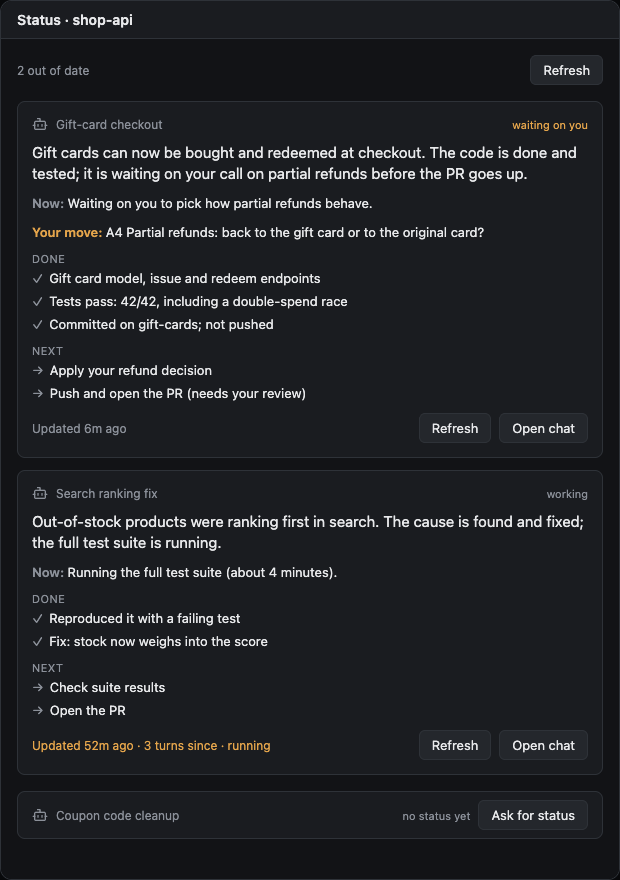
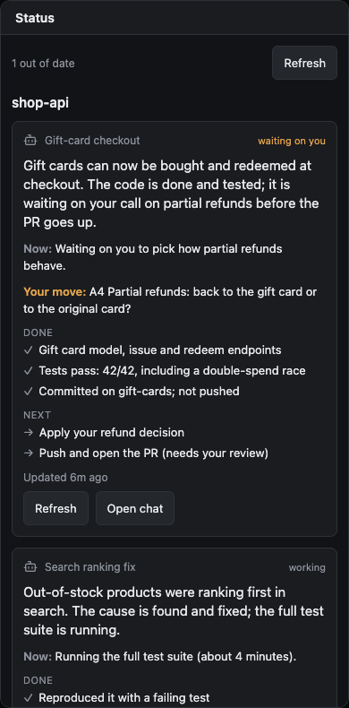

# Status for Paseo

Status is a [Paseo](https://paseo.sh) plugin. Each agent keeps a short, plain-language card saying where its work stands: a one or two sentence summary, what it is doing now, what is done and how we know, and what is next. You read the card instead of asking the agent "tldr, where are we?" and scrolling for the answer.

| Workspace panel: one card per agent, Refresh, an agent with no card yet | Every workspace, on a phone |
|---|---|
|  |  |

<sub>The screenshots render the plugin's own React Native components with sample data, using react-native-web (`preview/`). Inside Paseo they sit in its panel and screen chrome.</sub>

## What a card shows

- **Summary.** One or two sentences, written for someone who skipped the transcript.
- **State.** *working*, *waiting on you*, *blocked* or *done*.
- **Now.** What the agent is doing or waiting on this moment.
- **Done.** Finished steps, each with its proof: "tests pass: 42/42", "PR #7 merged, CI green", and "not pushed" when that is true.
- **Next.** What is left, in order, with what needs you marked.
- **Your move.** The agent's open asks, when [paseo-asks](https://github.com/fullstackhouse/paseo-asks) is installed.
- **Staleness.** How long ago the card was updated and how many turns have ended since. After two turns without an update it turns amber, so a card the agent forgot to update shows that it is out of date.

## Keeping cards current

- **Opening the panel** asks every agent whose card is stale (two or more turns without an update) for an update. It asks once per update, so reopening the panel never nags an agent that has not answered yet.
- **Refresh** at the top of the panel asks every agent whose card missed a turn, plus agents that have no card yet. Each card has its own **Refresh**, and an agent with no card has **Ask for status**.
- **`/paseo-status`** in an agent's composer asks that agent and opens the panel.
- If the agent is in the middle of a turn, the request waits until the turn ends, so it never interrupts. If the agent updates its card during that turn anyway, the request is dropped.
- **Agents created before the plugin was installed** have no `status_set` tool, since Paseo adds MCP servers only when an agent is created. When asked, they end their reply with a `paseo-status` JSON block instead, and the plugin reads the card from that reply.

## Where cards show up

- a **Status** panel in each workspace (⌘K: "Open status for this workspace");
- a **Status** screen covering every workspace (⌘K: "Open status across workspaces").

## How it works

```
agent ──stdio MCP──▶ bridge.mjs ──HTTP 127.0.0.1──▶ plugin server ──▶ ~/.paseo/plugin-data/status/
  ▲                    (inherits PASEO_AGENT_ID,                  │  workspaces/<id>.json
  │                     so every call knows its caller)           │
  └──── "[status] …" update request, held until the turn ends ────┘
```

- Every agent created after the plugin is installed gets a `status` MCP server with one tool, `status_set`. Its instructions tell the agent when to call it and how to write each field, so no `CLAUDE.md` edit is needed.
- Each call replaces the agent's whole status. The plugin counts the turns that end without a call; that count is the staleness shown on the card.
- The only text read from a transcript is a `paseo-status` block the agent was asked for. The card is only as current as the agent's last update, and the staleness says how current that is.

## Install

Paseo 0.12 or newer, with plugins enabled on the daemon.

```bash
git clone git@github.com:fullstackhouse/paseo-status.git
cd paseo-status && npm install
paseo plugin install "$PWD"
paseo plugin ls            # paseo-status should be "running"
```

Agents that already exist don't get the tool; they can still answer a request with a block in their reply (see above).

## From a terminal

The plugin writes the port and token of its local listener to `~/.paseo/plugin-data/status/server.json`, so scripts can ask for an update the way Refresh does:

```bash
S=~/.paseo/plugin-data/status/server.json
P=$(jq -r .port $S); T=$(jq -r .token $S)
curl -s -H "authorization: Bearer $T" -X POST localhost:$P/refresh -d '{"agentId":"…"}'
```

Right after the plugin loads, this returns `No daemon session yet` until an agent runs a turn or the panel is opened: Paseo hands plugin server code its daemon session through hooks and RPCs only.

## Develop

```bash
npm run typecheck      # client and server tsconfigs
npm test               # vitest: store, staleness, held and automatic refresh, reply fallback, asks lookup
paseo plugin reload paseo-status && paseo plugin logs paseo-status
cd preview && npm install && npm run dev   # the UI with sample data, at localhost:5198
```

## Design decisions

- **The agent writes its own status.** Only the agent knows where its work stands. A model summarising the transcript after every turn would cost a call per turn and could misread it.
- **Staleness instead of trust.** The card says how many turns it has missed, so a forgotten update is visible rather than silently wrong.
- **Never mid-turn.** An update request waits for the turn to end, because a prompt sent mid-turn interrupts the agent.
- **Separate from Asks.** Status says where the agent is; Asks says what it needs from you. They work alone or together, and Status only reads Asks' data.

## Limits

- Cards refresh by polling every 4 s. Paseo has no plugin channel for pushing updates to the app.
- It's unverified whether agents created before a daemon restart keep the tool after it.
