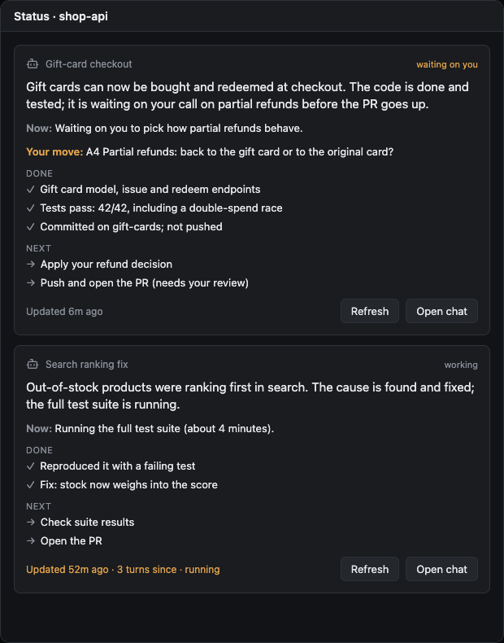
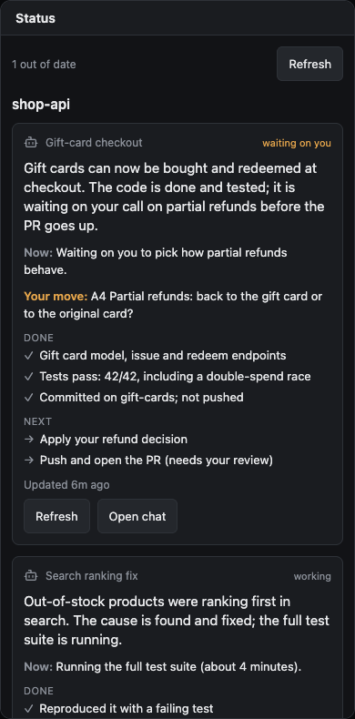
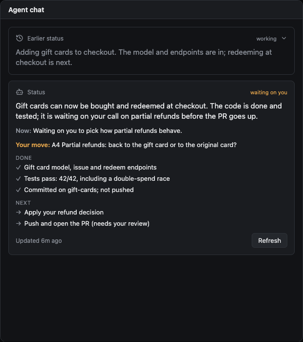
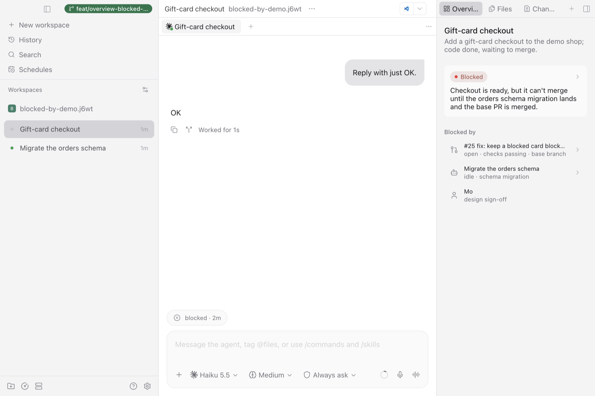

# Status for Paseo

Status is a [Paseo](https://paseo.sh) plugin. Each agent keeps a short, plain-language card saying where its work stands: a one or two sentence summary, what it is doing now, what is done and how we know, and what is next. You read the card instead of asking the agent "tldr, where are we?" and scrolling for the answer.

| Workspace panel: one card per agent, Refresh, an agent with no card yet | Every workspace, on a phone |
|---|---|
|  |  |



<sub>The screenshots render the plugin's own React Native components with sample data, using react-native-web (`preview/`). Inside Paseo they sit in its panel and screen chrome.</sub>

## What a card shows

- **Goal.** The whole job and its overall progress, for someone opening the workspace cold ("Ship the record-page redesign as 7 stacked PRs; 4 merged"). It stays until the agent sends a new one, so it doesn't shrink to the latest step.
- **Summary.** One or two sentences on where things stand right now, written for someone who skipped the transcript.
- **State.** *working*, *waiting on you* (you have to act), *blocked* (nothing can move until another workspace or another person acts, such as a peer's review; CI, builds and the agent's own subagents count as working) or *done*.
- **Blocked by.** A *blocked* card can name what it waits on: a PR (`owner/repo#N` or its URL), an agent, a workspace, a person or anything else. The card and Paseo's Overview list them: a PR with its state and checks (from `gh`), an agent or workspace by its title. In the Overview, pressing a row opens the PR, agent or workspace (needs an FSH Paseo build with `blockedBy`).

  
- **Now.** What the agent is doing or waiting on this moment.
- **Done.** Finished steps, each with its proof: "tests pass: 42/42", "PR #7 merged, CI green", and "not pushed" when that is true.
- **Next.** What is left, in order, with what needs you marked.
- **Your move.** The agent's open asks, when [paseo-asks](https://github.com/fullstackhouse/paseo-asks) is installed.
- **Sync asks.** A card that says *waiting on you* while its agent owns no open ask leaves you nothing to answer: what it waits on often lives in another workspace's asks, or is already settled. The card says so and offers **Sync asks**, which tells the agent to record each thing it waits on as an ask, close the stale ones, and correct its status. On FSH Paseo the Overview lists it under Your move with the same button.
- **Staleness.** How long ago the card was updated and how many turns have ended since. After two turns without an update it turns amber, so a card the agent forgot to update shows that it is out of date.

## Keeping cards current

- **Opening the panel** asks every agent whose card is stale (two or more turns without an update) for an update. It asks once per update, so reopening the panel never nags an agent that has not answered yet.
- **Refresh** at the top of the panel asks every agent whose card missed a turn, plus agents that have no card yet. Each card has its own **Refresh**, and an agent with no card has **Ask for status**.
- **`/paseo-status`** in an agent's composer asks that agent and opens the panel.
- If the agent is in the middle of a turn, the request joins that turn when its provider allows it (Claude, Codex, OpenCode, Pi), and otherwise waits until the turn ends, so it never interrupts. If the agent updates its card during that turn anyway, the request is dropped.
- **Agents created before the plugin was installed** have no `status_set` tool, since Paseo adds MCP servers only when an agent is created. When asked, they end their reply with a `paseo-status` JSON block instead, and the plugin reads the card from that reply.

## Where cards show up

- **inline in the agent's chat**, where it called `status_set`, folded to one line you press to open: the latest call opens to the live card (labels, age, Refresh); earlier calls open to what they said then, as "Earlier status". A status sent as a `paseo-status` reply block stays a code block in the reply;
- a **pill in each agent's composer**, next to Tasks and Subagents, showing the card's state and age (`waiting on you · 6m`, `working · 52m · stale`). Pressing it shows that agent's card in a popover. Agents without a card show `No status`, and the popover offers **Ask for status**;
- a **Status** panel in each workspace (⌘K: "Open status for this workspace"), which can also sit in the Explorer next to files and changes;
- a **Status** screen covering every workspace (⌘K: "Open status across workspaces").

## Snoozed workspaces

Snooze a workspace whose agent is waiting on other agents, and it comes back when the work needs you. When a card in a snoozed workspace turns *waiting on you* or *done* after you snoozed it, the plugin tells Paseo the workspace needs you (a *blocked* card waits on someone else, so it doesn't). Paseo treats that like a permission prompt: by default it wakes the workspace and notifies you (host Settings → Workspaces picks wake, count on Snoozed, or stay silent). A workspace you snoozed while it already needed you stays snoozed. Needs a Paseo host with `workspaceAttentionReport` (FSH builds).

## How it works

```
agent ──stdio MCP──▶ bridge.mjs ──HTTP 127.0.0.1──▶ plugin server ──▶ ~/.paseo/plugin-data/status/
  ▲                    (inherits PASEO_AGENT_ID,                  │  workspaces/<id>.json
  │                     so every call knows its caller)           │
  └──── "[status] …" request, steered into the turn or held ───────┘
```

- Every agent created after the plugin is installed gets a `status` MCP server with one tool, `status_set`. Its instructions tell the agent when to call it and how to write each field, so no `CLAUDE.md` edit is needed.
- **Helpers get no card.** An agent started by another agent (`create_agent`, so it carries a parent label) gets an empty `status` server: no tool and no instructions. The agent that started it reports status for the whole job. Cards helpers published before this are hidden, and helpers are left out of Refresh, "out of date" and the sidebar grouping. They keep their asks, so a button on an ask still goes to the agent that holds that work.
- Each call replaces the agent's whole status, except the goal: a call that leaves it out keeps the previous one, and an empty goal clears it. The Overview shows the newest goal any agent in the workspace set, above the newest card. The plugin counts the turns that end without a call; that count is the staleness shown on the card.
- **Blocked group.** A *blocked* card doesn't count as needing you (no row badge, no snooze wake-up); its workspace goes to Paseo's Blocked group, below the others. It stays there until the agent publishes a new status: replies, reminders and ask checks don't count as answering a blocked card, since it waits on someone else. Needs a Paseo build with the Blocked group.
- **Sidebar grouping** (Paseo's experimental agent-reported grouping): a card waiting on the human groups its workspace as needing you, a *blocked* card as Blocked (no needs-you badge; Paseo hosts before the Blocked group fall back to their own turn state), all-`done` cards as Done, and a `working` card as Working while live work backs it.
- **Working only while work is live.** A `working` card holds the workspace in Working only while something live backs it: the agent itself running, its background work (shells, Monitor watches) or subagents, or any agent it started (by parent link, recursively, in any workspace) doing any of that. Without that, it holds for 5 more minutes after the card's update or the last live work, to bridge gaps between turns, then Paseo's own turn state decides (Ready to review / Done). Subagents are only visible as the host showing the agent's workspace as running, so another agent or a working terminal in the same workspace also holds the card. Heartbeats and schedules aren't visible to plugins, so an agent waiting on one drops out of Working after the 5 minutes.
- **Blocked while a child works.** A *waiting on you* card is a snapshot: when you act in a child workspace and the agent it started there runs again, the parent gets no turn to notice. While the parent sits idle with no open ask and an agent it started (recursively) is live in another workspace, the sidebar, row badge and Overview read its card as *blocked* on that agent. The card itself is not rewritten, and it reads as written again once the child stops. A *done* card is left alone: the agent said its part is over, and work it handed off for good runs on its own. An agent that waits on a child's result says so with a *blocked* card naming it. Agents in the parent's own workspace (helpers like an asks check) don't count.
  When the last agent a parent started stops while the parent sits idle with a `working` or `blocked` card, Paseo itself usually tells the parent (agents created with `create_agent` notify their parent when they finish). If a minute later nothing has woken the parent (no turn, no card update, no child live again), the plugin prompts it once to check its children and update its status.
- The only text read from a transcript is a `paseo-status` block the agent was asked for. The card is only as current as the agent's last update, and the staleness says how current that is.

## Install

Paseo 0.12 or newer, with plugins enabled on the daemon.

```bash
git clone git@github.com:fullstackhouse/paseo-status.git
cd paseo-status && npm install
paseo plugin install "$PWD"
paseo plugin ls            # paseo-status should be "running"
```

Agents that already exist don't get the tool; they can still answer a request with a block in their reply (see above).

## From a terminal

The plugin writes the port and token of its local listener to `~/.paseo/plugin-data/status/server.json`, so scripts can ask for an update the way Refresh does:

```bash
S=~/.paseo/plugin-data/status/server.json
P=$(jq -r .port $S); T=$(jq -r .token $S)
curl -s -H "authorization: Bearer $T" -X POST localhost:$P/refresh -d '{"agentId":"…"}'
```

`POST /work-states` (same headers, empty body) returns the work state each workspace reports to the sidebar grouping. Like the sidebar's own poll, it may send a wake-up that has fallen due.

Right after the plugin loads, this returns `No daemon session yet` until an agent runs a turn or the panel is opened: Paseo hands plugin server code its daemon session through hooks and RPCs only.

## Develop

```bash
npm run typecheck      # client and server tsconfigs
npm test               # vitest: store, staleness, held and automatic refresh, reply fallback, asks lookup
paseo plugin reload paseo-status && paseo plugin logs paseo-status
cd preview && npm install && npm run dev   # the UI with sample data, at localhost:5198
```

## Design decisions

- **The agent writes its own status.** Only the agent knows where its work stands. A model summarising the transcript after every turn would cost a call per turn and could misread it.
- **Staleness instead of trust.** The card says how many turns it has missed, so a forgotten update is visible rather than silently wrong.
- **Never interrupting.** An update request joins a running turn when the provider takes a steer, and otherwise waits for the turn to end, because a prompt sent mid-turn would interrupt the agent.
- **Separate from Asks.** Status says where the agent is; Asks says what it needs from you. They work alone or together, and Status only reads Asks' data.

## Limits

- Cards refresh by polling every 4 s. Paseo has no plugin channel for pushing updates to the app.
- It's unverified whether agents created before a daemon restart keep the tool after it.
